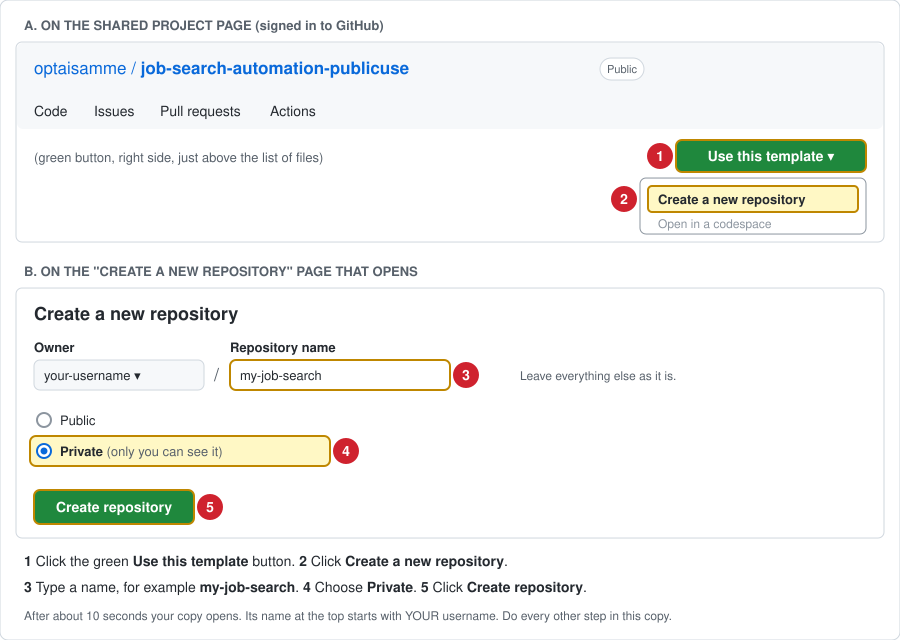

# Setup Guide (no coding needed)

This tool searches public job listings every week, checks each job against your rules
(location, salary, required experience and certifications), checks that the application
link works, and posts the results to you. It runs for free on GitHub's computers, so your
own computer does not need to be on. Everything is edited on the GitHub website.

## What you need

1. A free GitHub account: https://github.com/signup
2. About 30 minutes for first-time setup.

## Step 1: Make your own copy



1. Open the shared project page (the link you were given).
2. Click the green **Use this template** button, then **Create a new repository**.
   (If you don't see that button, ask the person who shared it to give you access.)
3. Name it, for example, `my-job-search`.
4. Choose **Private** so your profile stays private.
5. Click **Create repository**.

Every file you edit has **EDIT_ME** at the start of its name. Do not edit other files.
The [EDIT_ME_JOB_SEARCH_SETTINGS folder page](EDIT_ME_JOB_SEARCH_SETTINGS) lists them.

## Step 2: Set your search rules (EDIT ME file 1, required)

`EDIT_ME_JOB_SEARCH_SETTINGS/EDIT_ME_1_job_search_settings.toml` starts empty: no titles, no filters. You fill in the blanks: type
between the quotes `""` or the brackets `[]` on lines that do NOT start with `#`.
Lines starting with `#` are notes and examples; you never need to edit them.

A list is typed as items in quotes, separated by commas, inside brackets:
`["Salesforce Administrator", "Salesforce Admin"]`

1. In your new repository, open the `EDIT_ME_JOB_SEARCH_SETTINGS` folder, then `EDIT_ME_1_job_search_settings.toml`.
2. Click the pencil icon (Edit).
3. **Required, section 1:** in "Job title group 1", type at least one job title:

```toml
titles = ["Salesforce Administrator", "Salesforce Admin"]
description_must_mention_one_of = []
```

   Use groups 2 and 3 for other kinds of jobs, or leave them empty.
4. Optional, each off until you fill it in:
   a. Section 2: remote jobs only (`remote_only = "yes"` to start; change to `"no"` to also
      get hybrid and on-site jobs in your state), and your state (rejects jobs that exclude it).
   b. Section 3: salary minimums (`0` = no minimum).
   c. Section 4: words the description must mention, title words to skip, and the
      certification check.
   d. Section 5: requirement rules. Fill in a rule's name and terms, then change
      `on = "no"` to `on = "yes"`:

```toml
name = "Security clearance"
on = "yes"
terms = ["security clearance", "TS/SCI"]
reject_when = "mentioned"
```

      `reject_when = "required"` rejects a job only when it REQUIRES prior experience
      with a term; `"mentioned"` rejects it whenever a term appears.
   e. Section 6: search words (leave empty to search for your job titles).
   f. Section 7: companies to watch. Paste links to employers' job pages on Greenhouse,
      Lever, Ashby or SmartRecruiters. **Recommended:** the more companies you add, the more
      jobs each search finds. The file explains how to find the link.
5. Click **Commit changes** (green button), then **Commit changes** again.
6. The first step of every run ("Check settings files") lists exactly what is ON and
   OFF. If no job titles are set, the run stops there and says so.

## Step 3: Add your experience (EDIT ME file 2, optional)

`EDIT_ME_JOB_SEARCH_SETTINGS/EDIT_ME_2_my_experience.toml` also starts empty, with examples as notes.

1. Open `EDIT_ME_JOB_SEARCH_SETTINGS/EDIT_ME_2_my_experience.toml` and click the pencil icon.
2. For each skill you have, copy the example block to the bottom of the file, remove
   the `# ` marks, and fill in the skill, the words a job posting might use for it, and
   where you did it.
3. Include only things you have actually done. Do not add phone, email or address.
4. Commit changes.

Your profile never rejects a job. It is only used to explain how well each job fits you
and which requirements are not yet in your profile. It can stay empty.

## Step 4: Run your first search

Only after Steps 1 and 2 are done (your own copy, and at least one job title saved), follow
**[HOW_TO_RUN_A_SEARCH_NOW.md](HOW_TO_RUN_A_SEARCH_NOW.md)** once. Enabling the
workflow there (its Step 3) lets you start searches. Use the same guide any time you want
new results.

**Automatic weekly searches stay OFF** until you turn them on (Step 6, item 1).

## Step 5: Where to see your results

Open the **JOB_SEARCH_RESULTS** folder in your repository (on the **Code** tab).

1. **The folder's main page** opens automatically and shows your **latest results**:
   a. **Jobs that match all your rules**, with an **Apply** link for each.
   b. **Near misses:** jobs that failed exactly one of your rules, and which rule.
   c. **Jobs whose link could not be checked**, with a **Find employer posting** link.
2. **One numbered report per search**, for example `REPORT_001_2026-11-06_13-47_UTC.md`
   (search number, date, time in UTC). The newest is listed first. Each report also lists
   every job checked in that search and why it did or did not match.
3. **Issues tab:** a search that finds something new also adds a post titled
   **"Job search results: …"**. For email copies, click **Watch** (top right), then **All Activity**.
4. **Actions tab:** green check = the search worked; click it to see its results. Red X =
   click it, then the red step, to read what to fix.
5. The **first search** shows all jobs that already match. After that, each job is shown
   as new only once. A search with nothing new still adds a report to the folder.

## Step 6: Optional changes

1. **Turn on automatic weekly searches (EDIT ME file 3; they start OFF):**
   a. Open `.github/workflows/EDIT_ME_3_weekly_schedule.yml` and click the pencil icon.
   b. Change `AUTOMATIC_WEEKLY_SEARCH: "off"` to `AUTOMATIC_WEEKLY_SEARCH: "on"` (keep the quote marks).
   c. Commit changes. A search now runs by itself every week.
   d. To change the day or time, edit the line `cron: "47 13 * * 5"` in the same file. The
      format is `minute hour * * day-of-week`, in UTC time (Mountain Time is UTC minus 7 in
      winter, minus 6 in summer; day 5 = Friday). Example: `"0 15 * * 1"` = Mondays 15:00 UTC.
   e. While it is off, GitHub still starts the file at the weekly time, but it stops after a few
      seconds without searching. The Actions tab shows those as short runs with the search skipped.
2. **Free web search key (recommended).**
   Without a key, every search already checks 9 job sites and company careers pages. Adding
   one free key turns on a **web search**: for each of your job titles, the tool also searches
   the whole web, including company careers pages, and finds jobs that are on no job site. It
   also finds new companies to check. It is optional and stays off until you add the key.

| Service | What it adds | Where to get the free key | Secret name to add |
|---|---|---|---|
| **Tavily** (web search) | Searches the whole web for each of your job titles, including company careers pages | https://app.tavily.com: on the log-in page that opens, click **Sign up** (or continue with a Google, GitHub, LinkedIn or Microsoft account). After signing in, copy your API key from your Tavily account page (it starts with `tvly-`) | `TAVILY_API_KEY` |

   **Free plan:** 1,000 web searches a month, and no credit card, according to published
   comparisons (check Tavily's pricing page for the current plan). This tool uses 2 web searches
   per job title, for up to 4 titles: at most 8 per search, about 35 a month with weekly
   searches.

   **How to add the key:**

   1. Sign up at https://app.tavily.com and copy your API key (see the table).
   2. Open **your copy** of this project on github.com.
   3. Click **Settings** (top row of tabs, far right).
   4. On the left, click **Secrets and variables**, then **Actions**.
   5. Click the green **New repository secret** button.
   6. In **Name**, type `TAVILY_API_KEY` exactly (capital letters and underscores included).
      In **Secret**, paste the key. Click **Add secret**.
   7. Start a search. In the full report, the table "Where jobs were looked for" shows
      **Web search (Tavily): Yes** when it worked. "Off: needs a free key" means the secret is
      missing or its name is misspelled. "No: error" means the key was not accepted; check it
      and add it again.

   The key is private: only you can see it, and it is never shown in results. To remove it,
   open the same page and click the trash icon next to it.

   **Boards that do not offer keys:** LinkedIn, Indeed, Handshake, Idealist and the other popular
   boards on your results page offer no key for automated searching. Use the one-click search
   links on the results page for those.

## When you change your settings later

1. Edit the EDIT_ME file and commit. Changes take effect on the next run (weekly if turned on, or start
   one now with [HOW_TO_RUN_A_SEARCH_NOW.md](HOW_TO_RUN_A_SEARCH_NOW.md)).
2. Jobs still listed online are re-checked: a job that now passes is posted as
   **NEWLY VERIFIED**; one that now fails moves to **Rejected** in the report. Jobs
   already posted are never posted again.
3. To start over completely, delete `data/jobs.sqlite`; the next run is treated as a first
   run again.

## What it does not do

1. It never applies to jobs or contacts employers.
2. It does not search LinkedIn, Indeed, Handshake, Idealist and the other popular boards on
   the results page (no public data feed, sign-in required, or their terms do not allow it).
   The results page has one-click search links for them instead.
3. It searches Himalayas, The Muse, Remote OK, Jobicy, We Work Remotely, Working Nomads,
   Jobspresso, Remotive, Hacker News "Who is hiring?", and the careers pages of companies you
   add (settings section 7) or that it found earlier. It searches the wider web only if you
   add the free Tavily key.
4. Results come from text rules. When a posting is unclear, the job is marked "Needs
   Verification" rather than guessed, so read each posting yourself before applying.

## Running it on your own computer instead (optional)

1. Install Python 3.11 or newer: https://www.python.org/downloads/
2. Download your repository (green **Code** button, **Download ZIP**) and unzip it.
3. Open a terminal in that folder and run:

```bash
python3 -m jobsearch check
```

```bash
python3 -m jobsearch run
```

4. Results are written to the `JOB_SEARCH_RESULTS` folder.
